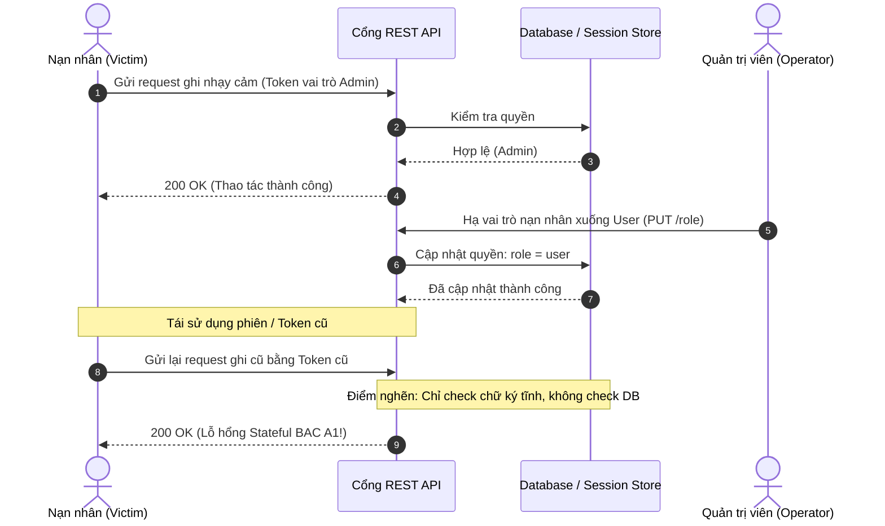
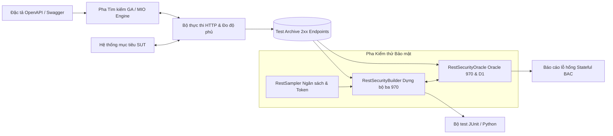
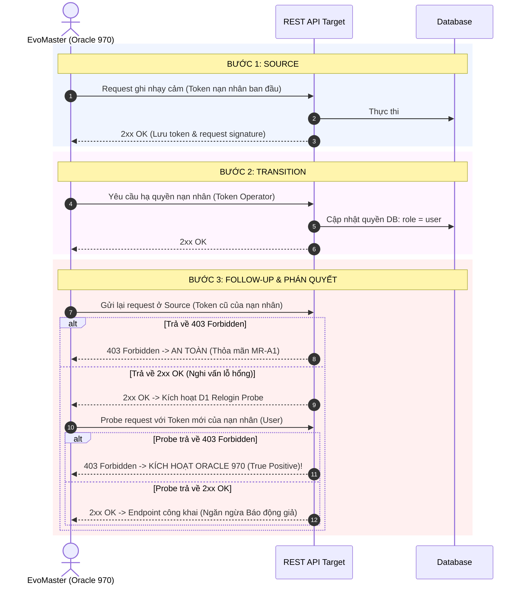
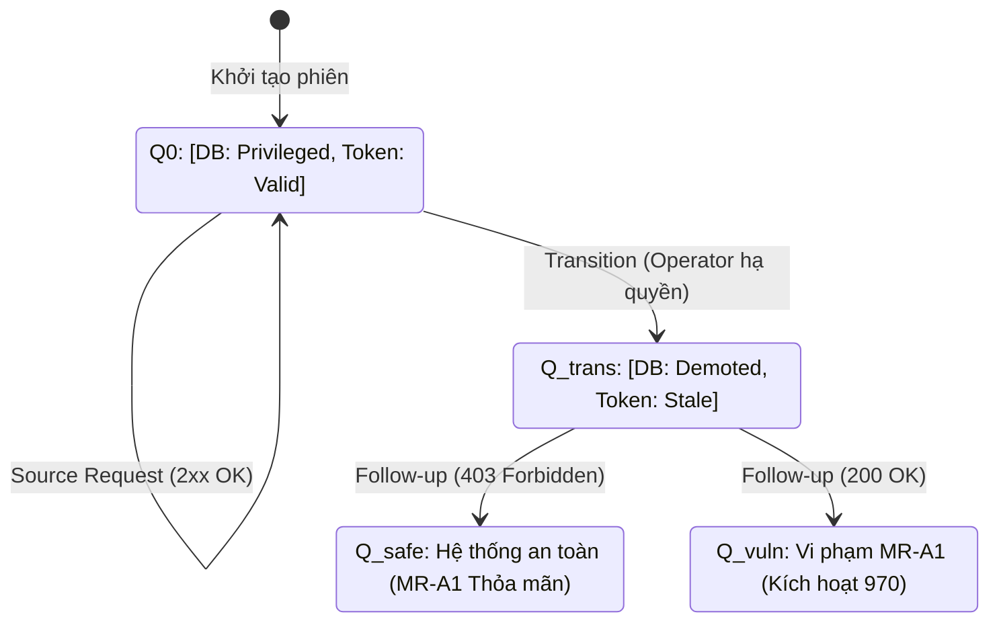
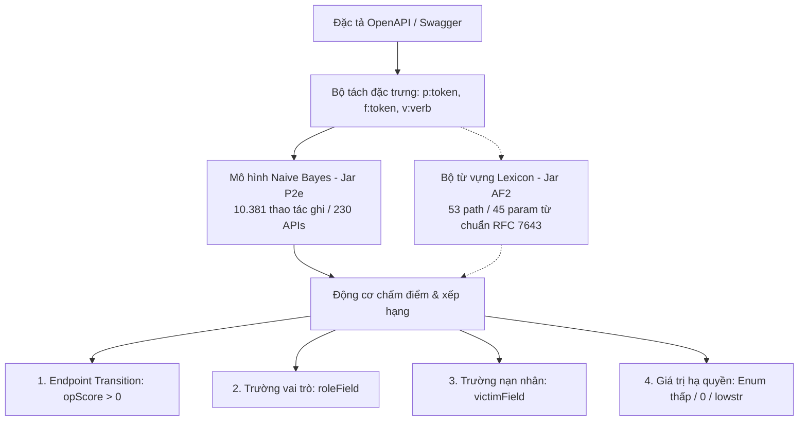

# Danh mục Hình vẽ & Sơ đồ Khóa luận (Thesis Figures Catalog)

Thư mục này chứa toàn bộ mã nguồn vector định dạng **TikZ (`.tex`)** và mã **Mermaid** trực quan tương ứng cho các hình vẽ trong Khóa luận tốt nghiệp.

---

## 1. Danh sách các file hình vẽ vector TikZ

| STT | Tên file TikZ | Mã hình | Tiêu đề hình vẽ trong Khóa luận | Chương |
| :---: | :--- | :---: | :--- | :---: |
| 1 | [`fig_1_1_stateful_authz_flaw.tex`](file:///c:/KLTN/graduational_thesis/thesis/figures/fig_1_1_stateful_authz_flaw.tex) | **Hình 1.1** | Minh họa vòng đời lỗ hổng phân quyền có trạng thái (A1) | Chương 1 |
| 2 | [`fig_2_1_evomaster_pipeline.tex`](file:///c:/KLTN/graduational_thesis/thesis/figures/fig_2_1_evomaster_pipeline.tex) | **Hình 2.1** | Kiến trúc tổng thể và chu trình sinh test của EvoMaster với Pha Security mở rộng | Chương 2 |
| 3 | [`fig_3_1_triple_sequence.tex`](file:///c:/KLTN/graduational_thesis/thesis/figures/fig_3_1_triple_sequence.tex) | **Hình 3.1** | Sơ đồ chuỗi thực hiện bộ ba `[source / transition / follow-up]` và kích hoạt Oracle 970 | Chương 3 |
| 4 | [`fig_3_2_mr_a1_state_space.tex`](file:///c:/KLTN/graduational_thesis/thesis/figures/fig_3_2_mr_a1_state_space.tex) | **Hình 3.2** | Không gian chuyển trạng thái phân quyền và Quan hệ kiểm thử suy biến MR-A1 | Chương 3 |
| 5 | [`fig_3_3_transition_inference.tex`](file:///c:/KLTN/graduational_thesis/thesis/figures/fig_3_3_transition_inference.tex) | **Hình 3.3** | Quy trình nhận diện và xếp hạng Transition tự động từ đặc tả OpenAPI | Chương 3 |
| 7 | [`fig_4_1_evomaster_integration.tex`](file:///c:/KLTN/graduational_thesis/thesis/figures/fig_4_1_evomaster_integration.tex) | **Hình 4.1** | Sơ đồ cấu trúc các module mở rộng tích hợp trong mã nguồn EvoMaster | Chương 4 |

> **Lưu ý.** Các hình đều là sơ đồ TikZ. Ba tệp hình cũ (Hình 3.4 về D1, Hình 5.1 và 5.2) đã gỡ khỏi bản thảo ngày 2026-10-26.

---

## 2. Cách chèn hình vào bản thảo LaTeX (`thesis/chapters/chapterX.tex`)

Do các hình vẽ được viết trực tiếp bằng TikZ, bạn chỉ cần dùng lệnh `\input{figures/<tên_file>.tex}` mà không lo bị vỡ hạt hay mờ khi zoom:

```latex
\begin{figure}[htbp]
  \centering
  \input{figures/fig_3_1_triple_sequence.tex}
  \caption{Sơ đồ chuỗi thực hiện bộ ba $[source / transition / follow-up]$ và cơ chế kích hoạt Oracle 970.}
  \label{fig:triple_sequence}
\end{figure}
```

---

## 3. Bản xem trước trực quan (Mermaid Diagrams)

Dưới đây là mã sơ đồ Mermaid tương đương cho từng hình vẽ, hiển thị trực tiếp trên giao diện Markdown:

### Hình 1.1: Minh họa vòng đời lỗ hổng phân quyền có trạng thái


### Hình 2.1: Kiến trúc tổng thể và chu trình sinh test EvoMaster


### Hình 3.1: Sơ đồ chuỗi bộ ba kiểm thử `[source / transition / follow-up]`


### Hình 3.2: Không gian trạng thái phân quyền và Quan hệ suy biến MR-A1


### Hình 3.3: Quy trình nhận diện và xếp hạng Transition từ OpenAPI


